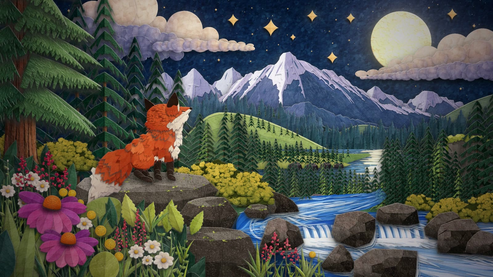
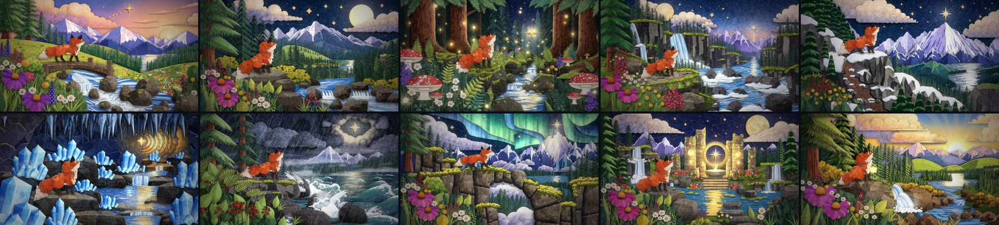

# Paper Fox

A one-minute layered paper-cut film, drawn and animated entirely in code.

A fox follows a guiding star through ten worlds: a dusk bridge, a moonlit lake, a
firefly forest, a waterfall canyon, snowy peaks, a crystal cave, a storm coast, an
aurora arch, a star portal, and finally dawn. Every frame is built from paper cut-outs
that are generated at runtime. The film loads no image files, textures, fonts or audio
samples: the paper fibre, the crumpled sky, every fur tuft, leaf, petal and wave, and
the soundtrack are all procedural. (The only images in this repository are stills
rendered from the film for this page.)



**Watch the film:** the 1080p60 render is attached to the
[latest release](https://github.com/Leonxlnx/paper-fox/releases/latest).



## How it works

**Paper engine** (`src/core`). A small Canvas 2D engine for multiplane paper dioramas.

- Textures are generated once per page load: fibre (grain, mottling, fibres, specks),
  crumpled paper (a lit Voronoi height field), granite speckle and felt.
- Shapes are drawn flat, then *baked* into sprites: texture is soft-lit into them, the
  cut edge gets a lit and an unlit bevel, and a blurred silhouette is kept as the drop
  shadow.
- Sprites sit on planes at different depths. A perspective camera films them, so a
  pan, push or crane gives real parallax, and every plane casts its shadow on the ones
  behind it. That shadow between layers is what makes it read as paper.
- A film finish adds bloom from bright paper and lights, a vignette and fine grain.

**Element library** (`src/elements`). Reusable, parameterised paper pieces: the fox
(a rigged cut-out with breathing, tail follow-through, ear flicks, a four-leg walk
cycle and a sitting pose), conifers and redwood trunks, flowers and foliage, skies,
moon, sun, aurora and the guiding star, cumulus banks and cloud seas, mountains, hills,
cliffs and boulders, lakes, rivers, waterfalls and foam. Each family has an API
reference in `docs/elements`.

**Scenes** (`src/scenes`). Ten dioramas composed from those elements, each animated as
a pure function of time with a slow camera move that passes through rest at its
midpoint.

**Film** (`src/film`). `timeline.js` is the one source of timing for picture and
sound: 80 BPM, two bars per scene, every scene change on a bar line. Each cut hides
behind something from the story world, so the fox is never seen twice:

| From → to | Transition |
|---|---|
| dusk → night lake | the camera tracks with the fox and a huge pine sweeps past the lens |
| lake → forest | a push through fir branches |
| forest → canyon | redwood trunks close like theatre curtains and open on the canyon |
| canyon → peaks | the camera cranes up through a bank of cloud |
| peaks → cave | a ragged rock iris closes on the fox and opens inside the mountain |
| cave → storm | the star at the end of the tunnel flares into lightning |
| storm → aurora | a paper wave rolls over the lens and drains away |
| aurora → portal | pop-up book: the cut-outs fold flat and the next world pops up |
| portal → dawn | the portal's light floods the frame and settles into the sunrise |

**Soundtrack** (`tools/audio`). Synthesized from scratch in JavaScript: a music-box
lullaby in D major with felt piano, pads, choir, harp and crystal bells, plus river,
crickets, wind, rain, thunder, waves and birds, and a motivated sound for every
transition. It reads the same timeline and cue list as the picture, so lightning and
thunder, the star appearing and its chime stay locked.

## Running it

Requires Node 20+, Chrome (or Chromium/Edge; set `CHROME_PATH` if it is not found) and
ffmpeg on the `PATH`.

```bash
npm install
```

Watch it live in the browser (space to pause, arrows to step):

```bash
node tools/serve.mjs
```

Then open `http://localhost:5173/` for the film, `?scene=s04` for one scene or
`?gallery=fox` for an element test sheet.

Render the soundtrack and the film (1920x1080, 60 fps, H.264 + AAC):

```bash
node tools/audio.mjs
```

```bash
node tools/render.mjs --audio out/audio/soundtrack.wav
```

Frames are rendered by several headless Chrome workers and deleted after encoding.
`--preview` renders at half resolution, `--from` / `--to` render a section.

Stills, contact sheets and comparisons for development:

```bash
node tools/snap.mjs s02 --t 4.25
```

```bash
node tools/sheet.mjs s02 --from 0 --to 8.5 --n 12
```

```bash
node tools/transition-sheet.mjs popup s08 s09
```

## Layout

```
src/core       paper engine: noise, colour, easing, geometry, textures, sprites, stage, finish
src/elements   reusable paper elements (fox, trees, flora, sky, clouds, terrain, water)
src/scenes     the ten dioramas
src/film       timeline, cues, transitions and their props
src/gallery    element test sheets
tools          headless rendering, soundtrack synthesis, review tools
docs           engine guide and element API references
```

## Credits

Built with Claude Code. The look recreates a set of AI-generated paper-cut
illustrations that were used only as visual reference; none of them are included here.

MIT licensed.
